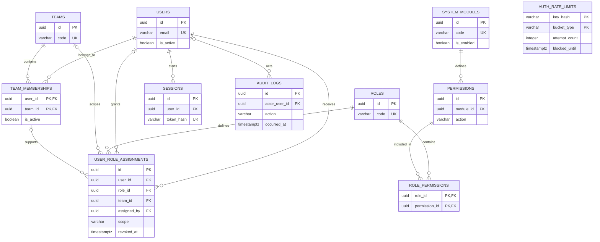

# Initial database design

## Status

Domain design for Phase C, updated to emphasize view permissions. Phase B
configures the connection and Alembic only; the tables below have not yet been
created. Alembic may create only its technical tracking table, `alembic_version`.

## Conventions

PostgreSQL 17. Identifiers use `uuid`; instants use `timestamptz` in UTC, with
presentation converted to America/Lima. `created_at` and `updated_at` initially
use server defaults; services update `updated_at` when changing a record.
All fields are NOT NULL unless marked NULL. No cascade deletes of history.
Entity and historical foreign keys use `ON DELETE RESTRICT`.

Editable tables `users`, `roles`, `permissions`, `teams`, `team_memberships`, and
`system_modules` have `created_at timestamptz` and `updated_at timestamptz`.
Join tables, assignments, and sessions use the specific timestamps listed below.

## Data dictionary

### users - individual accounts

| Field | Type | Constraint / meaning |
| --- | --- | --- |
| id | uuid | PK |
| email | varchar(254) | Normalized with trim + lowercase, UNIQUE |
| full_name | varchar(200) | Display name |
| password_hash | text | Argon2id hash; never serialize |
| is_active | boolean | Account enabled |
| created_at, updated_at | timestamptz | Entity timestamps |

A CHECK requires normalized email to enforce case-insensitive uniqueness.
Deactivation preserves identity for auditing. SSO will require an explicit
migration for external identities; that domain is not built in advance.

### roles - configurable permission sets

| Field | Type | Constraint / meaning |
| --- | --- | --- |
| id | uuid | PK |
| code | varchar(80) | UNIQUE, stable code |
| name | varchar(120) | Editable label |
| description | text NULL | Responsibility description |
| is_active | boolean | Inactive roles grant no permissions |
| created_at, updated_at | timestamptz | Timestamps |

A role does not contain a team: its assignment defines the scope. Role names
have no special meaning in authorization logic.

### system_modules - functional section catalog

| Field | Type | Constraint / meaning |
| --- | --- | --- |
| id | uuid | PK |
| code | varchar(80) | UNIQUE, stable, no periods |
| name | varchar(120) | Display name |
| description | text NULL | Purpose |
| is_enabled | boolean | Functional availability |
| created_at, updated_at | timestamptz | Timestamps |

Do not store SQL, React components, or executable code. Implemented frontend
routes reference permissions. Creating a row does not create a screen.

### permissions - module actions

| Field | Type | Constraint / meaning |
| --- | --- | --- |
| id | uuid | PK |
| module_id | uuid | FK system_modules.id |
| action | varchar(80) | Stable code, no periods |
| description | text NULL | Meaning for administrators |
| created_at, updated_at | timestamptz | Timestamps |

UNIQUE `(module_id, action)`. `view` is a first-class action controlling views
and their data. The public code is derived as module + period + action.
Do not add columns such as `can_see_analytics` to users. Adding a capability
requires a catalog entry, not a column migration.

### role_permissions - positive role grants

| Field | Type | Constraint / meaning |
| --- | --- | --- |
| role_id | uuid | Part of PK; FK roles.id |
| permission_id | uuid | Part of PK; FK permissions.id |
| created_at | timestamptz | Grant timestamp |

PK `(role_id, permission_id)`. Additional index on `permission_id` for reverse
lookups. Removing a relationship is audited in the same transaction; its
history remains in `audit_logs`.

### teams - organizational units

| Field | Type | Constraint / meaning |
| --- | --- | --- |
| id | uuid | PK |
| code | varchar(80) | UNIQUE |
| name | varchar(120) | Label |
| description | text NULL | Context |
| is_active | boolean | Inactive teams grant no contextual access |
| created_at, updated_at | timestamptz | Timestamps |

No team hierarchy or approval process is defined yet.

### team_memberships - team membership

| Field | Type | Constraint / meaning |
| --- | --- | --- |
| user_id | uuid | Part of PK; FK users.id |
| team_id | uuid | Part of PK; FK teams.id |
| is_active | boolean | Current membership |
| created_at, updated_at | timestamptz | Timestamps |

PK `(user_id, team_id)`; index `(team_id, is_active)`. Membership alone grants
no permissions. Retain the row when removing membership to preserve references.

### user_role_assignments - roles and scope

| Field | Type | Constraint / meaning |
| --- | --- | --- |
| id | uuid | PK |
| user_id | uuid | FK users.id |
| role_id | uuid | FK roles.id |
| scope | varchar(16) | CHECK IN ('global', 'team') |
| team_id | uuid NULL | FK teams.id; required only for team scope |
| assigned_by | uuid NULL | FK users.id; NULL for system bootstrap |
| created_at | timestamptz | Grant timestamp |
| revoked_at | timestamptz NULL | Revocation; CHECK >= created_at |

CHECK: `(scope = 'global' AND team_id IS NULL) OR (scope = 'team' AND team_id IS NOT NULL)`.
Composite FK `(user_id, team_id)` references `team_memberships(user_id, team_id)`
with MATCH SIMPLE: global assignments with NULL team_id do not require membership.

Partial unique indexes:

```sql
CREATE UNIQUE INDEX uq_assignments_active_global
ON user_role_assignments (user_id, role_id)
WHERE scope = 'global' AND revoked_at IS NULL;

CREATE UNIQUE INDEX uq_assignments_active_team
ON user_role_assignments (user_id, role_id, team_id)
WHERE scope = 'team' AND revoked_at IS NULL;
```

Add indexes on `role_id`, `team_id`, `assigned_by`, and `user_id` for historical
queries. Foreign keys verify existence; services and permission evaluation
verify active status. Removing membership locks its row, deactivates it, and
revokes contextual assignments in one transaction. Creating a contextual
assignment locks the same membership row and checks active status to coordinate
concurrent operations. Reactivating membership never restores roles without
an explicit new grant.

### sessions - server-managed opaque sessions

| Field | Type | Constraint / meaning |
| --- | --- | --- |
| id | uuid | PK |
| user_id | uuid | FK users.id |
| token_hash | varchar(64) | UNIQUE; SHA-256 hash of a random token |
| csrf_token_hash | varchar(64) | CSRF token hash |
| created_at | timestamptz | Creation |
| last_seen_at | timestamptz | Last activity |
| expires_at | timestamptz | Absolute expiration; CHECK > created_at |
| revoked_at | timestamptz NULL | Revocation |

Indexes on `user_id` and `expires_at`. Tokens use cryptographic entropy; fast
hashing is suitable for random tokens, not passwords. Do not store permissions
in sessions: changes must be reflected on the next request. Deliver the raw
CSRF token through the session flow; it may rotate when requested again. Define
that lifecycle during Phase C implementation.

### audit_logs - sensitive action history

| Field | Type | Constraint / meaning |
| --- | --- | --- |
| id | uuid | PK |
| actor_user_id | uuid NULL | FK users.id; NULL for anonymous failures/system actions |
| action | varchar(120) | Event code |
| entity_type | varchar(80) | Affected entity type |
| entity_id | uuid NULL | Descriptive reference, not a polymorphic FK |
| result | varchar(16) | CHECK IN ('success', 'failure') |
| occurred_at | timestamptz | Event timestamp |
| request_id | uuid | Correlation ID; also generated for CLI commands |
| metadata | jsonb | Explicitly allowed data; defaults to an empty object |

Indexes on `occurred_at`, `(actor_user_id, occurred_at)`, `(entity_type, entity_id)`,
and `request_id`. No `updated_at`: events are immutable to the application.
Record necessary changes only; never passwords, tokens, cookies, complete
headers, or login request bodies. Retention is pending; no automatic purge.

### auth_rate_limits - shared technical counters

| Field | Type | Constraint / meaning |
| --- | --- | --- |
| key_hash | varchar(64) | Part of PK; key derived from account or IP |
| bucket_type | varchar(16) | Part of PK; CHECK IN ('account', 'ip') |
| window_start | timestamptz | Window start |
| attempt_count | integer | CHECK >= 0 |
| blocked_until | timestamptz NULL | Temporary block expiration |
| updated_at | timestamptz | Last update |

PK `(key_hash, bucket_type)`; index on `updated_at` for cleanup. Use atomic
increments and a service-managed window policy. No user FK, allowing limits
on nonexistent accounts without revealing their existence. Thresholds are
configurable and must account for shared corporate IPs. Trust forwarded headers
only when they originate from the configured proxy.

## Relationships

Users N:M teams through memberships. Roles N:M permissions through
role_permissions. Users N:M roles through scoped assignments. One module has
many permissions; one user has many sessions and audit events. An audit event
may have no authenticated actor. Each contextual assignment is backed by a
membership. Technical rate-limit counters are independent.



## How the three access relationships work together

This is the planned behavior for Phase C, not an active database feature today.
The public Phase B welcome page does not read these tables or enforce permissions.

| Relationship | Question answered | Does it grant access by itself? |
| --- | --- | --- |
| `team_memberships` | Which teams does this user belong to? | No. It establishes organizational membership. |
| `role_permissions` | Which views/actions does this role permit? | No. A role must be assigned to a user. |
| `user_role_assignments` | Which role does this user hold, and where does it apply? | It grants the role's permissions only while the assignment and all applicable conditions are valid. |

For example, suppose an active user named Alex belongs to North and South.
Illustrative role names and permission codes below are not seeded business rules.
Display names represent foreign-key IDs for readability.

`team_memberships`:

| User | Team | is_active |
| --- | --- | --- |
| Alex | North | true |
| Alex | South | true |

`role_permissions`:

| Role | Permission |
| --- | --- |
| Receipt reader | receipts.view |
| Analytics reader | analytics.view |

`user_role_assignments`:

| User | Role | scope | team_id | revoked_at |
| --- | --- | --- | --- | --- |
| Alex | Receipt reader | team | North | NULL |
| Alex | Analytics reader | global | NULL | NULL |

Assuming the roles and modules are enabled, Alex can view receipts for North
and has global analytics access. Alex cannot view South receipts merely because
of South membership. A North receipt grant also does not allow editing receipts:
that would require a separate action. The precise analytics datasets and receipt
operations remain future business decisions.

For a team-scoped resource, the planned backend evaluation is:

1. Validate the session and active user.
2. Find the required permission and verify its module is enabled.
3. Find an unrevoked user assignment to an active role containing that permission.
4. Accept a global assignment, or require a matching team plus active membership
   and active team for a contextual assignment.
5. Filter collection queries by the same effective scope. Deny when no grant applies.

Membership creation grants nothing automatically. Adding a permission to a role
affects everyone assigned that role, within their assignment scopes. Revoking one
user assignment does not modify the role or other users. Removing a permission
from one role does not remove matching grants from another role. Global grants
do not require team memberships and are not revoked merely by leaving one team.
Removing membership revokes that user's assignments for that team; rejoining
requires new assignments. Audit records preserve changes.

This separation keeps view access configurable through data without adding a
column per view to users or hardcoding role names. Planned validation is mapped
under RBAC-01 through DATA-03 in the [test map](testing.md).

## Flexibility decisions

- No per-view columns or authorization based on role names.
- Extensible catalog; `view` controls read access even without write operations.
- Positive grants combine by scope, without premature hierarchies or denials.
- No payment, analytics, receipt, or approval tables until processes are defined.
- Energy can be registered as disabled with initial permissions in Phase C.
- Access changes use catalog rows and assignments; domain rule changes require
  implementing the corresponding module.

Constraint and index reference: [PostgreSQL 17](https://www.postgresql.org/docs/17/ddl-constraints.html).
