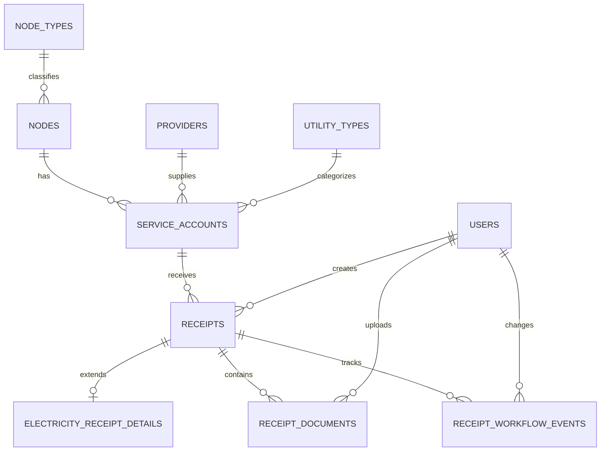

# WEB-PAYM — Database & Architecture Proposal v1

**Status:** Proposed for review; not approved for migrations  
**Initial scope:** Electricity only  
**Design objective:** Clean, pragmatic, normalized PostgreSQL schema with reusable patterns for future utilities.

## 1. Business context

WEB-PAYM replaces an Excel-based process for **recording, tracking, validating, and archiving** information about payments to national utility providers. **It does not execute payments.**

Current electricity workflow (to validate with business users):
1. Employee downloads receipts from provider sources.
2. Employee enters receipt data into WEB-PAYM; incomplete drafts can be saved.
3. Employee enters corresponding information in the company's existing CRM and tracks CRM progress in WEB-PAYM.
4. Finance pays externally.
5. Employee obtains payment proof and sends it to the provider.
6. Employee updates the record; **`paid` is the final overall receipt status**. Supporting documents and history remain available.

The exact order, exception paths, and requirements for reaching `paid` are still to be confirmed.

## 2. Architectural principles

- **Modular monolith:** Keep the existing React/TypeScript/Vite frontend, FastAPI/SQLAlchemy 2 backend, PostgreSQL 17, and Alembic migrations.
- **Shared business core:** Nodes, providers, service accounts, receipts, documents, and workflow history are reusable across utilities.
- **Electricity extension:** Store electricity-only attributes in `electricity_receipt_details`; add other utility extensions only when needed.
- **Pragmatic normalization:** Target 3NF, avoid repeated provider/node data in receipts, and avoid excessive catalog or intermediary tables.
- **Moderate constraints:** Enforce primary keys, foreign keys, and basic integrity; avoid speculative uniqueness rules and premature mandatory fields.
- **Security:** Reuse existing users, authentication, RBAC, and audit infrastructure. Enforce authorization server-side when implementing business endpoints.
- **Traceability:** Preserve important status changes and document metadata.
- **Business terminology:** Keep `nodes`, `providers`, `supply_id`, `receipts`, `status`, `status_crm`. Use `receipt`, not `bill`, in project names and tables.
- **No speculative frameworks:** No microservices, generic form builder, configurable workflow engine, or tables for future utilities at this stage.

## 3. Proposed new tables

All primary key types, timestamps, and naming conventions must be aligned with the existing repository before implementation. `PK` and `FK` below describe relationships, not a mandated UUID/integer strategy.

### 3.1 `utility_types` — utility catalog

| Column | Suggested PostgreSQL type | Notes |
|---|---|---|
| `id` | PK | Existing project ID convention |
| `code` | VARCHAR(30) | Unique; initially `electricity` |
| `name` | VARCHAR(100) | Display name |
| `is_active` | BOOLEAN | Default true |

### 3.2 `node_types` — node classification

| Column | Type | Notes |
|---|---|---|
| `id` | PK | |
| `code` | VARCHAR(20) | Unique; TX, AX, MC |
| `name` | VARCHAR(100) | Description |

### 3.3 `nodes` — company sites/assets

| Column | Type | Notes |
|---|---|---|
| `id` | PK | |
| `code` | VARCHAR(50) | Unique where business-confirmed |
| `name` | VARCHAR(200) | E.g. `T4249_SM_SANTA LUCIA` |
| `node_type_id` | FK → `node_types.id` | |
| `is_active` | BOOLEAN | Default true |
| `created_at` | TIMESTAMPTZ | |
| `updated_at` | TIMESTAMPTZ | |

The example node name and separate node code must be checked against actual source data; do not infer a code by parsing the name without a business rule.

### 3.4 `providers` — service providers

| Column | Type | Notes |
|---|---|---|
| `id` | PK | |
| `name` | VARCHAR(200) | E.g. Electro Oriente S.A.C. |
| `tax_id` | VARCHAR(20) | Optional; uniqueness to verify |
| `region` | VARCHAR(100) | Optional text initially; clarify whether location or coverage |
| `is_active` | BOOLEAN | Default true |
| `created_at` | TIMESTAMPTZ | |
| `updated_at` | TIMESTAMPTZ | |

Do not introduce a region catalog unless needed.

### 3.5 `service_accounts` — supply/account association

| Column | Type | Notes |
|---|---|---|
| `id` | PK | |
| `node_id` | FK → `nodes.id` | |
| `provider_id` | FK → `providers.id` | |
| `utility_type_id` | FK → `utility_types.id` | Electricity initially |
| `supply_id` | VARCHAR(100) | Provider-issued identifier; preserve leading zeros |
| `is_active` | BOOLEAN | Default true |
| `created_at` | TIMESTAMPTZ | |
| `updated_at` | TIMESTAMPTZ | |

A node may have multiple service accounts in the proposed model; actual electricity cardinality remains unconfirmed. Do not assume `supply_id` is globally unique. Confirm whether `(provider_id, supply_id)` is a valid unique key and how provider/account changes are represented historically.

### 3.6 `receipts` — shared receipt record

| Column | Type | Notes |
|---|---|---|
| `id` | PK | |
| `service_account_id` | FK → `service_accounts.id` | Determines node, provider, utility |
| `receipt_number` | VARCHAR(100) | Nullable for drafts / providers without this field |
| `period_start` | DATE | Nullable until known |
| `period_end` | DATE | Nullable until known |
| `issue_date` | DATE | Nullable |
| `due_date` | DATE | Nullable |
| `amount` | NUMERIC(18,2) | Nullable for drafts |
| `currency_code` | CHAR(3) | `PEN` initially; default/required policy TBD |
| `status` | VARCHAR(40) | Overall workflow; **final: `paid`** |
| `status_crm` | VARCHAR(40) | Separate CRM progress |
| `created_by` | FK → existing `users.id` | Match actual user key |
| `created_at` | TIMESTAMPTZ | |
| `updated_at` | TIMESTAMPTZ | |

Keep `status` and `status_crm` on `receipts` for simple current-state queries. Validate allowed values and transitions in backend application logic initially; do not add status catalog tables yet. Exact intermediate statuses are **not finalized**. Receipt periods are actual date ranges, not stored as strings like `2026-03`; month-only cases must be investigated.

### 3.7 `electricity_receipt_details` — electricity extension

| Column | Type | Notes |
|---|---|---|
| `receipt_id` | PK + FK → `receipts.id` | One-to-one extension |
| `consumption_kwh` | NUMERIC(14,3) | Nullable until entered |

Only add tariff, meter readings, etc. when confirmed by actual receipt/Excel data. Ensure in application logic that electricity details are only attached to electricity receipts.

### 3.8 `receipt_documents` — file metadata

| Column | Type | Notes |
|---|---|---|
| `id` | PK | |
| `receipt_id` | FK → `receipts.id` | |
| `document_type` | VARCHAR(40) | E.g. receipt PDF, payment proof; final codes TBD |
| `original_filename` | VARCHAR(255) | |
| `storage_key` | TEXT | Reference to protected storage, not raw file bytes |
| `uploaded_by` | FK → existing `users.id` | |
| `uploaded_at` | TIMESTAMPTZ | |

Document access must follow authorization rules. Whether sending proof to the provider needs separate evidence/status is still open.

### 3.9 `receipt_workflow_events` — status history

| Column | Type | Notes |
|---|---|---|
| `id` | PK | |
| `receipt_id` | FK → `receipts.id` | |
| `field_name` | VARCHAR(40) | E.g. `status`, `status_crm` |
| `old_value` | VARCHAR(100) | Nullable |
| `new_value` | VARCHAR(100) | |
| `changed_by` | FK → existing `users.id` | |
| `created_at` | TIMESTAMPTZ | |

Capture meaningful workflow transitions, not necessarily every field edit. Reuse existing audit facilities where appropriate; avoid redundant tracking.

## 4. Relationships (conceptual ERD)

**Example (fictional):** Node `T4249_SM_SANTA LUCIA` → service account with `supply_id=001234567`, provider Electro Oriente S.A.C., utility electricity → monthly receipts, each with `status`, `status_crm`, amount and dates → electricity consumption, documents, workflow history.

## 5. Workflow and user experience

- **Receipt entry:** Reusable receipt form with electricity-specific consumption section; draft saving and later completion.
- **CRM tracking:** Employee continues entering information in the existing CRM; WEB-PAYM stores independent `status_crm`.
- **Payment tracking:** Finance executes payment outside WEB-PAYM; WEB-PAYM records progress and supporting proof. `paid` is the final overall `status`.
- **Documents:** Attach original receipt and payment proof; preserve controlled access and references.
- **Archive/search:** Retrieve completed records and history; determine whether archival is a separate flag/action or a view filtered by final status.
- **History:** Record who changed important statuses and when.

Do not assume CRM integration/API automation; initial process is manual. Do not conflate CRM registration with payment completion.

## 6. Database conventions and integrity

- Follow existing SQLAlchemy models, Alembic migration patterns, primary key types and naming conventions.
- Use foreign keys for entity relationships; unique catalog codes; appropriate timestamps.
- Use `NUMERIC` for money and kWh, `DATE` for business dates, `TIMESTAMPTZ` for audit times, text for identifiers with leading zeros.
- Permit nullable fields needed for drafts; validate completeness before later workflow transitions.
- Avoid premature unique constraints on receipt period/number until duplicates, adjustments and corrected receipts are understood.
- Index foreign keys and frequently queried fields as actual access patterns emerge; avoid indiscriminate indexes.
- No financial-history hard deletion by default; exact cancellation/correction policy TBD.
- Do not store uploaded file content directly in these business tables.
- Keep status values simple and controlled by backend logic; no dynamic workflow engine or status catalogs initially.

## 7. Backend and frontend boundaries (illustrative, not directories to create yet)

**Backend:** shared master-data, receipt, document and workflow responsibilities; electricity-specific validation/details as an extension. Apply existing session authentication and RBAC dependencies to business endpoints.

**Frontend:** reusable receipt entry/list/detail components, electricity-specific fields, CRM/payment progress indicators, document upload, and archive/search. Build shared patterns before additional utilities; no generic form builder.

**Future utilities:** Reuse `nodes`, `providers`, `service_accounts`, `receipts`, documents and workflow history; add a specialized detail table and form/validation logic only when required. No water/telecom implementation now.

## 8. Open decisions — must confirm before migrations

1. Actual Excel headers and representative redacted electricity receipts: required fields and document variations.
2. Whether nodes have one or multiple electricity supply IDs, and how supply/provider changes are handled.
3. Scope of Supply ID uniqueness across providers.
4. Whether receipts always contain a date range or sometimes only a billing month.
5. Exact `status` transitions, exception/rework paths, and conditions for final `paid`.
6. Exact `status_crm` values and responsible users.
7. Payment cases: one-to-one, partial, grouped payments; payment reference and date requirements.
8. Whether proof delivery to provider and archive validation need separate fields/events.
9. Receipt duplicate/correction rules, provider tax ID and region semantics.
10. Confirm compatibility with existing models and migrations before selecting final PK types and constraints.

## 9. Recommended implementation sequence (after approval)

1. Review existing repo conventions and validate business inputs/Excel mapping.
2. Approve finalized data dictionary and ERD.
3. Implement master data/catalog tables and migrations; test.
4. Implement receipts and electricity extension; test.
5. Implement document metadata and workflow event tracking; test.
6. Define business permissions and apply backend authorization; test.
7. Implement modular receipt UI and operational workflow incrementally.

**Current instruction to agent:** Review and report only. Do not modify files, create migrations, implement features, or resume RBAC C.4.2 until explicitly approved.
