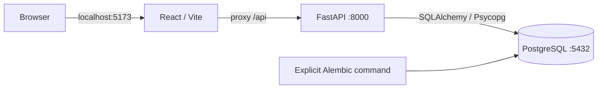

# Technical guide

## Status and architecture

Prepared on 2026-10-13. Phase B of deliverable 01.

A modular monolith using React/TypeScript/Vite and FastAPI/Python 3.12.
Synchronous SQLAlchemy 2 and Psycopg 3 connect to PostgreSQL 17; Alembic manages
the schema. Tailwind CSS 4 uses its Vite plugin. UI components are local source
with shadcn/ui configuration; Button uses Radix Slot and CVA.

React Router manages routes, and TanStack Query provides the query client.
React Hook Form and Zod are installed for Phase D forms. Argon2 and
email-validator are installed for Phase C; this does not mean login is
implemented. There is no Redis, queue infrastructure, or external service.



In production, Nginx will replace Vite as the static file server and API proxy.
The final HTTPS configuration is pending. The supplied Compose configuration
is for local development, not production deployment.

## Organization and responsibilities

| Location | Responsibility |
| --- | --- |
| `frontend/src/app` | Global providers |
| `frontend/src/features` | Screens and logic grouped by feature |
| `frontend/src/components/ui` | Reusable presentation components |
| `frontend/src/services` | HTTP transport and shared errors |
| `frontend/src/routes` | Routes; protection planned for Phase D |
| `backend/app/api` | Endpoint composition and HTTP dependencies |
| `backend/app/core` | Configuration and future security |
| `backend/app/db` | Metadata and connection lifecycle |
| `backend/app/modules` | Per-module entities and services, Phase C |
| `infrastructure` | Dockerfiles and future proxy configuration |
| `docs` | Contracts, decisions, and evidence |

Future backend modules separate ORM models, Pydantic schemas, transactional
services, and routers. Routers must not make arbitrary commits or contain
business rules. Application services own transactions.

All project content must be in English: UI text, metadata, documentation,
comments, docstrings, validation errors, and script output. Keep identifiers
and permission codes stable. The presentation timezone remains America/Lima;
using English does not change the business timezone.

## Development file watching

The frontend mounts local source, HTML, Vite configuration, and TypeScript
configuration into `/app`. Configure polling under `server.watch`, not at the
top level of the Vite configuration. A 300 ms interval supports Windows/Docker
bind mounts where filesystem event notifications may be lost, at the cost of
additional filesystem checks.

The original Compose file mounted only source and HTML, leaving Vite configuration
at its image-build version. The configuration mounts correct that issue. Existing
containers must be recreated once to receive the new mounts; restarting a
container does not apply Compose configuration changes. See the README command.
No automatic deployment or container restart is performed by this source change.

References: [Vite server.watch](https://vite.dev/config/server-options#server-watch)
and [Compose restart behavior](https://docs.docker.com/reference/cli/docker/compose/restart/).

## Configuration and secrets

`Settings` reads the root `.env` or process environment variables, with process
variables taking precedence. Compose passes only necessary variables to each
service. The frontend receives no credentials. `API_PROXY_TARGET` configures
only the development server and does not use the `VITE_` prefix.

| Variable | Purpose |
| --- | --- |
| `APP_ENV` | development, test, or production |
| `APP_NAME` | Public application name |
| `POSTGRES_*` | Connection settings; password represented as `SecretStr` |
| `FRONTEND_PORT`, `BACKEND_PORT` | Ports published by Compose |
| `API_PROXY_TARGET` | Proxy destination when running locally |
| `COOKIE_SECURE` | Reserved for sessions; must be true in production |
| `SESSION_ABSOLUTE_SECONDS` | Future maximum session duration: 28800 seconds |
| `SESSION_IDLE_SECONDS` | Future inactivity limit: 1800 seconds |

`URL.create` builds the SQL URL, so passwords with special characters need no
manual escaping. Never log a URL containing a password. Configuration rejects
insecure cookies and the example password in production; these checks do not
replace TLS setup or production review.

## Connections and schema changes

A pool of 5 connections plus 5 overflow connections uses `pool_pre_ping` and a
5-second connection timeout. Each request has one SQL session. Closing it rolls
back uncommitted transactions. The engine is disposed on application shutdown.

Migrations do not run automatically for each worker. Operators run Alembic
explicitly. Register all entities in `app/db/models.py` so `--autogenerate` sees
the metadata. Always review generated SQL.

Future schema change procedure:

1. Update models and the data dictionary.
2. Generate `alembic revision --autogenerate -m "description"`.
3. Review constraints, indexes, existing data, and reversibility.
4. Test `upgrade`, `alembic check`, and recovery on a test database.
5. Apply to the target environment with a backup and documented procedure.

## Health contract

`GET /api/v1/health/live`: 200 when the process responds, without requiring PostgreSQL.

`GET /api/v1/health/ready`: executes `SELECT 1`; returns 200 if the connection
works or 503 with a generic message. It does not yet check the schema revision
because business tables do not exist. Extend in Phase C if deployment requires it.

Swagger is exposed only outside production. There is no open CORS policy:
browser and API share an origin through the proxy. Compose publishes ports on
loopback only. PostgreSQL uses host port 55432 and container port 5432.

## Reproducible dependencies

Frontend: `package.json` declares compatible ranges; `package-lock.json` locks
the full resolution. Install using `npm ci`; do not edit the lock manually.

Backend: `pyproject.toml` declares dependencies. pip-tools resolves
`requirements.txt` and `requirements-dev.txt` with hashes. Install with
`pip install --require-hashes -r ...`. Both locks must use matching runtime
versions. pip-tools is a maintenance tool, not an application dependency.

To regenerate from backend with Python 3.12:

```powershell
.venv/Scripts/python.exe -m pip install pip-tools==7.6.2
.venv/Scripts/python.exe -m piptools compile --generate-hashes --strip-extras --output-file requirements.txt pyproject.toml
.venv/Scripts/python.exe -m piptools compile --generate-hashes --strip-extras --extra dev --constraint requirements.txt --output-file requirements-dev.txt pyproject.toml
```

Locks resolved on Windows are also verified in Linux containers. Base images
use compatible version families (Python 3.12, Node 24, PostgreSQL 17), not immutable
digests. Digest pinning and an image update policy belong to production deployment.

## Future security tests

Phase C will cover valid/invalid login, inactive users, 401/403 responses,
view permissions on API endpoints, team isolation, revocation, CSRF, login
limits, duplicate assignments, and privilege escalation prevention. Use real
PostgreSQL rather than substituting SQLite for its constraints.

## Technical sources

- [Vite](https://vite.dev/guide/)
- [Tailwind for Vite](https://tailwindcss.com/docs/installation/using-vite)
- [shadcn/ui](https://ui.shadcn.com/docs/installation/manual)
- [FastAPI in Docker](https://fastapi.tiangolo.com/deployment/docker/)
- [PostgreSQL constraints](https://www.postgresql.org/docs/17/ddl-constraints.html)
- [OWASP sessions](https://cheatsheetseries.owasp.org/cheatsheets/Session_Management_Cheat_Sheet.html)
